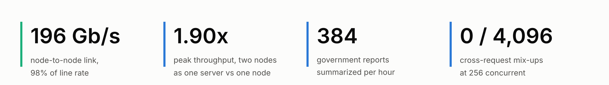

# Multi-Node LLM Inference on Two NVIDIA DGX Sparks

[](https://github.com/JacobWillson13/dgx-spark-cluster/actions/workflows/ci.yml)
[](LICENSE)
[](https://creativecommons.org/licenses/by/4.0/)

Two NVIDIA DGX Sparks joined by one 200 GbE cable and run as a single vLLM inference cluster. What was measured: how fast the link is, how to split a model across the two nodes, when the second node is worth having, and what lower precision costs in accuracy. Every throughput number passed a correctness gate first, and every prediction was recorded before its run. The full write-up is [REPORT.md](REPORT.md).



## Findings

1. **Split the model, don't copy it.** One server across both nodes (TP2) matched or beat two independent servers at every load from 4 to 256 concurrent requests: 1.77x their throughput at 4, tied at 256. It peaked at 1.90x one node. [Section 9](REPORT.md#9-when-the-second-spark-is-worth-it)
2. **The second node helps even when the model fits on one.** Each node reads half the weights at the same time, so single-stream decode runs 1.82x faster, and long-document summarization runs 1.78x faster at the same quality. [Sections 6.2, 9.3](REPORT.md#62-one-node-versus-two)
3. **Tensor parallelism beats pipeline parallelism over the link, 2x.** The pilot predicted the opposite. The deciding quantity is transfer volume (a few MB per token), not the link's bandwidth ratio. [Section 5](REPORT.md#5-predictions-and-outcomes)
4. **FP8 is nearly free; NVFP4 is not.** On all 1,319 GSM8K problems, FP8 scored 1.8 points below BF16 and NVFP4 13.7 points below, both significant on a paired test. [Section 8.3](REPORT.md#83-precision-and-answer-quality)
5. **Check correctness under load before trusting throughput.** A published two-Spark recipe reported 300 tok/s from a model that was answering every prompt with a numbered list. Here, 4,096 concurrent requests each returned their own answer and no one else's. [Sections 7.1, 9.4](REPORT.md#71-why-a-correctness-gate)

## Two Sparks: what to run

| If you need | Use | Measured (Qwen3.8 27B BF16) |
|---|---|---|
| Fast responses for a few people | TP2, one server on both nodes | 116 to 151 ms per token up to 16 concurrent requests; one node never gets below 212 ms |
| Maximum batch throughput | TP2 | 324 tok/s at 256 concurrent, against 170 at best on one node |
| Long documents in bulk | TP2 | 384 reports per hour against 215, same ROUGE |
| A model larger than one node (70B BF16) | TP2 | The only way to serve it: 3.4 tok/s single-stream, 64 tok/s at 32 concurrent |
| More KV-cache capacity at little accuracy cost | FP8 weights | 1.45x the KV tokens of BF16, -1.8 points on GSM8K |
| Two independent copies (DP2) | Not recommended | Never ahead of TP2; same total at saturation, half the speed per request |

## Results at a glance

<table>
<tr>
<td width="50%"></td>
<td width="50%"></td>
</tr>
<tr>
<td><b>Throughput against latency.</b> TP2 (blue) sits below and right of both alternatives: more throughput at lower latency. One node hits its KV-cache wall past 128 requests.</td>
<td><b>What the second node buys.</b> TP2 holds 1.73x to 1.82x one node at every load. Two separate servers start at 1.02x and only catch up when both are saturated.</td>
</tr>
<tr>
<td></td>
<td></td>
</tr>
<tr>
<td><b>Tensor versus pipeline parallelism.</b> Llama 3.3 70B across the link: TP2 is 2.01x faster single-stream and 1.65x at 32 concurrent.</td>
<td><b>The precision trade.</b> FP8 keeps accuracy and adds 45% KV capacity. NVFP4 adds 64% and costs 14 points.</td>
</tr>
<tr>
<td></td>
<td></td>
</tr>
<tr>
<td><b>A real workload.</b> 100 government reports, median 9,033 tokens: 1.78x throughput, half the wait for the first token, same summary quality.</td>
<td><b>Where the time goes.</b> Weight streaming dominates. Measured cross-node communication explains Qwen's two-node overhead, but not Llama's 22 ms remainder.</td>
</tr>
</table>

More figures, all regenerated from [`results/`](results/): the [link rate](figures/interconnect.png), [one node versus two](figures/one_vs_two.png), the [eager-mode constant](figures/weight_streaming.png), [eager versus compiled](figures/eager_vs_compiled.png), and [how the parallelism strategies differ](figures/parallelism.png).

## Predictions, scored


Each prediction was written down before the run that tested it, and the misses stay in the record. Several of the most useful results came from misses: pipeline parallelism losing, the second node helping a single user, and two servers never overtaking one split server. Every prediction, its measured value and its report section: [`results/predictions.csv`](results/predictions.csv).

## The cluster


- **Hardware:** 2 x NVIDIA DGX Spark (GB10 Grace Blackwell, 128 GB unified memory at 273 GB/s, sm_121).
- **Network:** a direct 200 GbE QSFP cable between the ConnectX-7 ports for inference traffic, driven over both PCIe paths for 196 Gb/s; a 10 GbE switch and a laptop on a private subnet for management.
- **Software:** native vLLM 0.29.0 with Ray and NCCL over RDMA, PyTorch 2.13, FlashInfer 0.6.18, NCCL 2.29.7, Ray 2.58.0, DGX OS 7.6.0. The pilot used a containerized vLLM in eager mode; its versions are in the report.

NVIDIA's Cluster Assistant configures the link: two addresses per node, one per PCIe path, then a link test. Its 185.2 Gbps is the dual-path rate before jumbo frames; with MTU 9000 the link measures 196 Gb/s.

<p>
  
  
</p>

## All headline numbers

| Test | Configuration | Result |
|---|---|---|
| Link bandwidth | Both PCIe paths, MTU 9000 | 196.03 Gb/s (98% of line rate); one path 111.7 Gb/s |
| Link latency | `ib_write_lat` | about 1.7 µs |
| TP2 vs PP2 | Llama 3.3 70B, concurrency 1 / 32 | 2.01x / 1.65x in TP2's favor |
| Two nodes vs one | Qwen3.8 27B, concurrency 1, compiled | 115 vs 210 ms per token (1.82x) |
| Decode efficiency | Llama 3.3 70B TP2, concurrency 1 | 87.7% of the 273 GB/s ceiling |
| Eager-mode overhead | Pilot, all configurations | about 30 ms per forward pass |
| CUDA graphs | Qwen one node / Llama TP2 | overhead 29 to 9 ms / unchanged at 31 ms |
| Cross-node all-reduce | 16 KB message, inside a CUDA graph | about 55 µs |
| Peak throughput | Qwen3.8 27B, 256 concurrent | TP2 324 tok/s; DP2 323; one node 170 (at 128) |
| Long documents | 100 GovReport reports, 16 at a time | TP2 384 reports/hour; one node 215 |
| KV-cache capacity | Qwen3.8 27B, relative to BF16 weights | FP8 1.45x; NVFP4 1.64x |
| GSM8K | Qwen3.8 27B, all 1,319 items | BF16 73.1%, FP8 71.3%, NVFP4 59.4% |
| Cross-request contamination | Echo gate, 256 concurrent | 0 in 4,096 requests (below 0.07% at 95%) |

## Reproduce

Build the cluster with [docs/SETUP.md](docs/SETUP.md), then certify each configuration before measuring it with [docs/VALIDATION.md](docs/VALIDATION.md): node health, launch, correctness gate, then the benchmark. The scripts are in [`validation/bin/`](validation/bin/).

On any machine, without a cluster:

```bash
pip install -r requirements.txt
python3 scripts/make_figures.py                     # every figure, from results/
cd validation && python3 -m unittest test_check test_memory_watchdog test_analysis
```

## Repository

| Path | Contents |
|---|---|
| [`REPORT.md`](REPORT.md) | Full write-up: method, predictions, results, platform traps, known limits |
| [`docs/SETUP.md`](docs/SETUP.md) | Networks, ConnectX-7 link, native vLLM, one- and two-node serving |
| [`docs/VALIDATION.md`](docs/VALIDATION.md) | Run protocol, correctness gate and stop rules |
| [`validation/`](validation/) | Validation, sweep and analysis scripts, with unit tests |
| [`results/`](results/) | Every measurement as CSV, indexed in [`results/README.md`](results/README.md) |
| [`figures/`](figures/) | Charts, regenerated by [`scripts/make_figures.py`](scripts/make_figures.py) |

## How it was run

Planning, review and the report were done with an AI assistant (Claude). Commands ran on the cluster through a coding agent (OpenAI Codex) following the written procedures in `docs/VALIDATION.md`, under guardrails: one passwordless root command (dropping the page cache), a memory watchdog on every launch, and hard stop rules with no automatic retries. When the watchdog stopped a run, the cause and the fix were recorded before the rerun. Details: [report section 11](REPORT.md#11-how-it-was-run).

## Citation and license

If you use these measurements or scripts, cite them with [CITATION.cff](CITATION.cff) (GitHub's "Cite this repository" button).

Code is under the [MIT License](LICENSE). The report, documentation and figures are under [CC BY 4.0](https://creativecommons.org/licenses/by/4.0/). The product images in `figures/assets/` are manufacturer photos used for illustration and are not covered by either license. GovReport documents are by GAO and CRS; only aggregate scores are published here.

Jacob Willson
