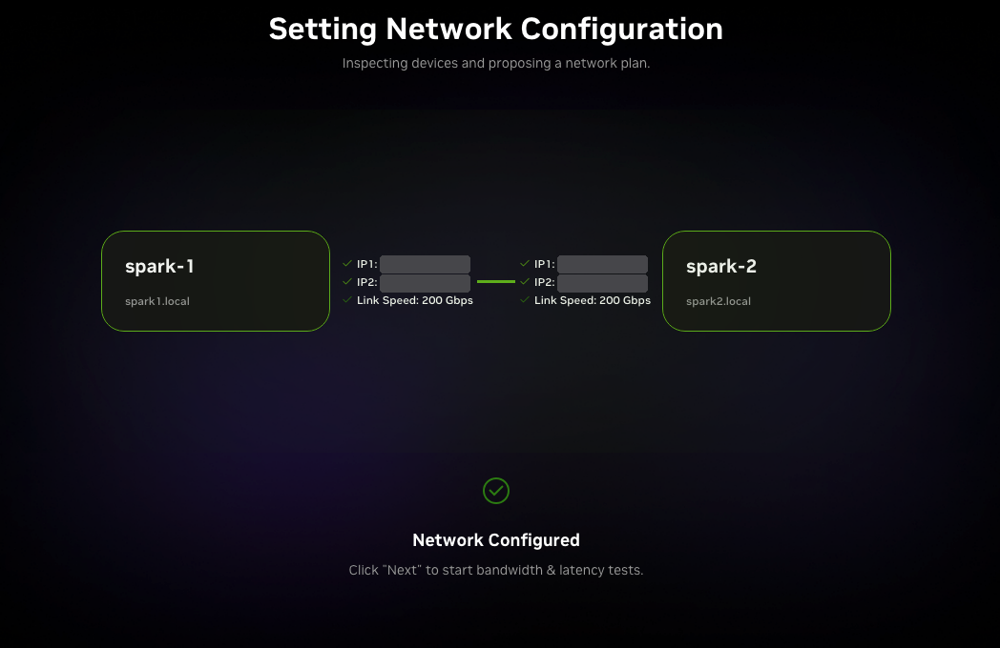

# Multi-Node LLM Inference on Two NVIDIA DGX Sparks

Two NVIDIA DGX Spark nodes, connected by a direct 200 GbE ConnectX-7 link and a separate management network, serving LLMs across both nodes with vLLM. This repository contains the setup guide, the validation scripts, the measured data and a full report: [REPORT.md](REPORT.md).

## What was built

- **Hardware:** 2 x NVIDIA DGX Spark (GB10 Grace Blackwell, 128 GB unified memory at 273 GB/s, sm_121).
- **Network:** a direct 200 GbE QSFP cable between the two ConnectX-7 ports for inference traffic; a 10 GbE switch and a laptop on a private subnet for management.
- **Software:** vLLM serving one model across both nodes with Ray and NCCL over RDMA. Pilot runs used a containerized vLLM in eager mode; later runs used native vLLM 0.29.0 on DGX OS 7.6.0.

## What was tested

- ConnectX-7 link bandwidth and latency, one PCIe path versus both
- Tensor parallelism (TP2) versus pipeline parallelism (PP2) across the link
- One node versus two for a model that fits on one
- Single-stream decode against the memory-bandwidth ceiling
- KV-cache capacity at BF16, FP8 and NVFP4
- A correctness gate under concurrent load, required before any throughput number is counted

Predictions were recorded before each pilot experiment and scored afterward (report section 5).

## Results

| Test | Configuration | Result |
|---|---|---|
| Link bandwidth | Both PCIe paths, MTU 9000, `ib_write_bw` | 196.03 Gb/s (98% of line rate) |
| Link bandwidth | One PCIe path | 111.7 Gb/s |
| Link latency | `ib_write_lat` | about 1.7 µs |
| TP2 vs PP2 | Llama 3.3 70B, concurrency 1 | 3.39 vs 1.69 tok/s (2.01x) |
| TP2 vs PP2 | Llama 3.3 70B, concurrency 32 | 65.3 vs 39.5 tok/s (1.65x) |
| Two nodes vs one | Qwen3.8 27B, concurrency 1 | 5.71 vs 3.64 tok/s (1.57x); 130 vs 230 ms per token |
| Decode efficiency | Llama 3.3 70B TP2, concurrency 1 | 87.7% of the 273 GB/s ceiling |
| Fixed overhead | Pilot, eager mode, all configurations | about 30 ms per forward pass |
| KV-cache capacity | Qwen3.8 27B, relative to BF16 | NVFP4 weights 1.64x; FP8 KV cache 1.35x |
| Single-node throughput | Qwen3.8 27B, native stack, concurrency 64 | 120.7 tok/s; ceiling about 191 sequences |

**Status:** the pilot ran in eager mode. A rerun of the pilot on the compiled native stack is planned; report section 8 lists its predictions, and results will be added there.

## Setup screenshots

NVIDIA's Cluster Assistant configures the ConnectX-7 link: two addresses per node, one per PCIe path, then a link test. Its 185.2 Gbps is the dual-path rate before jumbo frames; with MTU 9000 the link measures 196 Gb/s. Full steps: [docs/SETUP.md](docs/SETUP.md).

  
  

## Repository

| Path | Contents |
|---|---|
| [`REPORT.md`](REPORT.md) | Full write-up: method, predictions, results, platform findings, known limits |
| [`docs/SETUP.md`](docs/SETUP.md) | Build the cluster: networks, ConnectX-7 link, native vLLM, single- and two-node serving |
| [`docs/VALIDATION.md`](docs/VALIDATION.md) | Certify a configuration before benchmarking it: run protocol, correctness gate, stop rules |
| [`validation/`](validation/) | The validation scripts and their unit tests |
| [`results/`](results/) | Measured data as CSV |
| [`figures/`](figures/) | Charts, regenerated from `results/` by [`scripts/make_figures.py`](scripts/make_figures.py) |

Software versions: native vLLM 0.29.0, PyTorch 2.13, FlashInfer 0.6.18, NCCL 2.29.7, Ray 2.58.0 on DGX OS 7.6.0. Pilot versions are listed in the report.

## License

Code is under the [MIT License](LICENSE). The report, documentation and figures are under [CC BY 4.0](https://creativecommons.org/licenses/by/4.0/). The product images in `figures/assets/` are manufacturer photos used for illustration and are not covered by either license.

Jacob Willson
