# Multi-Node LLM Inference on Two DGX Sparks

Jacob Willson · October 2026

## 1. Summary

Two NVIDIA DGX Spark systems were joined over a direct 200 GbE ConnectX-7 cable and run as one vLLM inference cluster. The work had three stages: a pilot that compared parallelism strategies with predictions recorded in advance, a calibration phase that moved to a native software stack and built a correctness-gated measurement method, a closing rerun of the pilot on that stack, and a concurrency sweep with a real long-document workload to decide how a second Spark should be used.

Main results:

- **Link bandwidth:** 196.03 Gb/s, 98% of line rate, with both PCIe paths driven at once. One path reaches about 112 Gb/s at any frame size.
- **Tensor versus pipeline parallelism:** TP2 was 2.01x faster than PP2 on single-stream decode and 1.65x faster at concurrency 32 (Llama 3.3 70B). The pilot predicted PP2 would win.
- **One node versus two:** splitting Qwen3.8 27B across both nodes gave 1.57x single-stream throughput and 1.77x lower per-token latency, although the model fits on one node. The pilot predicted no single-stream gain.
- **Decode efficiency:** single-stream decode reached 87.7% of the 273 GB/s memory-bandwidth ceiling. In eager mode, every configuration also paid about 30 ms per forward pass beyond weight streaming.
- **Compiled stack:** CUDA graphs removed most of the 30 ms constant on Qwen3.8 27B (29 to 9 ms on one node, about 30 to 15 ms with TP2) and none of it on Llama 3.3 70B TP2. Measured cross-node collectives explain under a third of Llama's remainder.
- **Precision:** on all 1,319 GSM8K items, FP8 scored 1.8 points below BF16 and NVFP4 13.7 points below, both significant on a paired test.
- **How to use the second Spark:** one server split across both nodes (TP2) matched or beat two independent servers at every load from 4 to 256 concurrent requests: 1.77x their throughput at 4, even at 256 (324 against 323 tok/s). TP2 peaked at 1.90x one node.
- **Long documents:** summarizing 100 government reports, TP2 delivered 384 reports per hour against 215 on one node (1.78x), at the same summary quality.
- **Correctness gate:** on the native stack, each configuration had to return correct answers, with no cross-request contamination, under concurrent load before its throughput was counted.

Twenty predictions were recorded across the four stages, each before its run; eight held. The scorecard is below, with every prediction in [`results/predictions.csv`](results/predictions.csv).

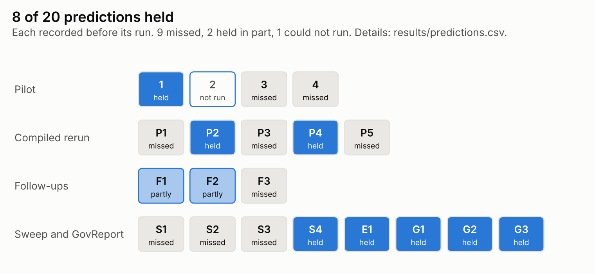

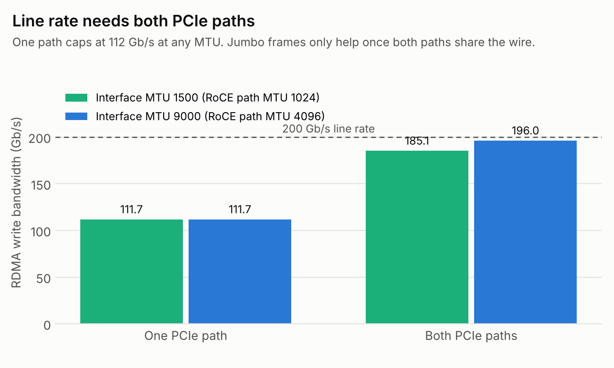

## 2. System

Each DGX Spark is a GB10 Grace Blackwell system-on-chip: a 20-core Arm CPU and a Blackwell GPU (compute capability sm_121) sharing 128 GB of LPDDR5x at 273 GB/s. The operating system reports about 121 GiB to an inference server, and that figure, not the nominal 128 GB, decides whether a model fits on one node.

| Component | Specification |
|---|---|
| Nodes | 2 x NVIDIA DGX Spark (`spark1`, `spark2`) |
| SoC | GB10 Grace Blackwell, 20-core Arm CPU + Blackwell GPU, sm_121 |
| Memory | 128 GB LPDDR5x unified per node, 273 GB/s |
| Interconnect | ConnectX-7, one 200 GbE QSFP direct-attach cable |
| Management | 10 GbE RJ-45 per node into a switch; a laptop on the same private subnet |

Two networks with separate jobs:

- **Management network:** SSH, administration and file movement, on a small private subnet with static addresses and no DHCP.
- **ConnectX-7 cable:** every byte the inference engine moves between nodes.

Keeping them apart means an administrative session cannot disturb a benchmark, and a benchmark cannot lock an operator out.

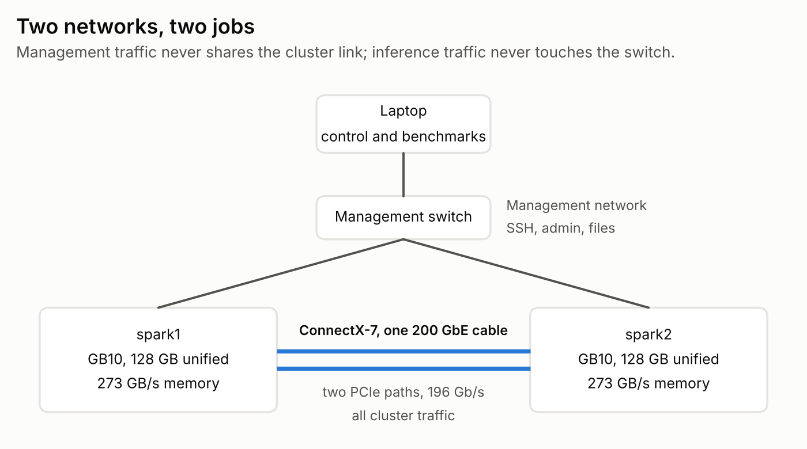

## 3. Interconnect

The ConnectX-7 adapter presents each physical port as two logical interfaces, one per PCIe path into the SoC (`enp1s0f1np1` and `enP2p1s0f1np1`). With one cable installed, both are views of the same wire. A benchmark that drives one interface measures one PCIe path, and one path cannot saturate a 200 GbE port.

| Configuration | RoCE path MTU | Per path (Gb/s) | Aggregate (Gb/s) | Line rate |
|---|---:|---:|---:|---:|
| One path | 1024 | 111.72 | 111.72 | 55.9% |
| Both paths | 1024 | 92.57 | 185.14 | 92.6% |
| One path | 4096 | 111.73 | 111.73 | 55.9% |
| **Both paths** | **4096** | **98.01 / 98.02** | **196.03** | **98.0%** |

Two hardware properties show up in that table:

- **One path caps near 112 Gb/s.** Jumbo frames change single-path throughput by 0.01 Gb/s, which is noise.
- **Jumbo frames lift the aggregate by 10.9 Gb/s.** Larger frames only matter once two paths contend for the same wire.

RoCE derives its path MTU from the interface MTU: 1500 gives 1024, and 9000 gives 4096.

NVIDIA's Cluster Assistant reported 185.2 Gb/s in its own link test. That matches the dual-path measurement at path MTU 1024 to within noise; the test ran before the MTU change.

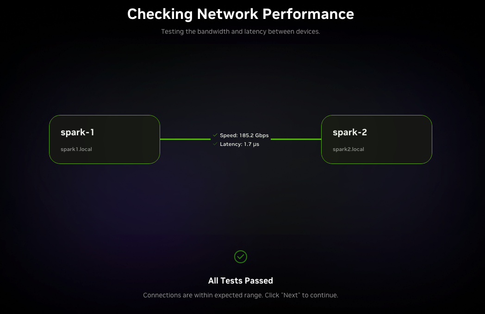

Latency carries one warning. `ping` reports 1.1 to 2.0 ms across this link because ICMP goes through the kernel network stack. RDMA bypasses it and measures 1.7 µs. Anyone validating this link with `ping` will conclude it is broken.

## 4. Method

### 4.1 Parallelism

Each Spark has one GPU, so every multi-node configuration is a two-way split across the wire. The two strategies differ only in how they divide the model:

- **Tensor parallelism (TP2):** splits every layer, so both nodes work on each layer at once and exchange partial results.
- **Pipeline parallelism (PP2):** splits by depth, so a token passes through node one, then node two.

Ray coordinates multi-node serving; vLLM's multiprocess backend cannot span hosts.

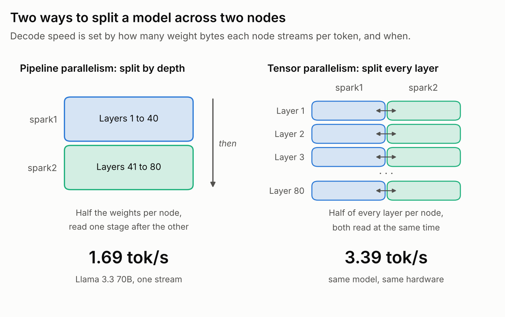

### 4.2 What the benchmark sends

Every pilot run used vLLM's built-in random dataset. It downloads nothing: it builds prompts by walking consecutive token IDs from a random start and decoding them to text, then corrects the length until the server sees exactly what was asked for. The prompts are real vocabulary in a meaningless order. Hardware cost per token is the same whether text is coherent or not.

Every request in every run had exactly **1024 input tokens and 256 output tokens**, with a fixed seed. That makes comparisons across configurations clean. It also means the absolute numbers describe fixed-length synthetic traffic, not a production mix.

Later stages added correctness prompts, GSM8K and real government reports (sections 7.1, 8.3 and 9.3). All five prompt types:

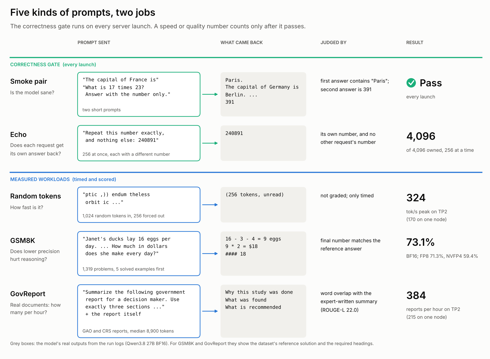

### 4.3 Pilot configuration

| Setting | Value | Why |
|---|---|---|
| Memory fraction | 0.85 | The 0.92 default fails the startup check on unified memory |
| Max model length | 8192 | Fixed context budget |
| Prompt shape | 1024 in / 256 out | No length variation |
| Concurrency | 1 and 32 | 5 prompts at 1, 64 at 32 |
| Execution | Eager | One compiled configuration took over 37 minutes to compile |
| Load generator | `vllm bench serve` | No custom harness to defend |

Pilot stack: vLLM 0.19.2rc1 (CUDA 13 nightly container), Ray 2.58.0, PyTorch 2.11.0, NCCL 2.28.9, September 2026.

Eager mode penalizes every run equally, so comparisons between configurations hold. Absolute numbers are floors. Section 8 tests that claim.

## 5. Predictions and outcomes

Four predictions were recorded before measurement. Two were falsified.

| Prediction | Outcome |
|---|---|
| Single-stream decode lands at 80 to 90% of the memory-bandwidth ceiling | **Confirmed:** 87.7% (TP2) and 87.3% (PP2) for Llama 3.3 70B |
| DeepSeek V4 Flash decodes much faster than Llama 3.3 70B (about 11x fewer active parameters) | **Not tested:** the model was unsupported on this stack |
| Pipeline parallelism beats tensor parallelism across the link | **Falsified:** TP2 won every metric |
| A second node helps throughput under load but not single-stream latency | **Falsified:** single-stream improved 1.57x |

**Why pipeline parallelism was expected to win.** Memory runs at 273 GB/s and the link at 24.5 GB/s, about 11x slower. Tensor parallelism exchanges data at every layer; pipeline parallelism only at the stage boundary. On that framing the link looks like the bottleneck.

**Why that was wrong.** The deciding quantity is transfer *volume*, not the bandwidth ratio.

- **Tensor parallelism** moves a few megabytes per token, a fraction of a millisecond over this link against a 259 ms memory budget. Section 7 later measured it directly on Qwen3.8 27B: 3.68 MB per output token.
- **Each node also reads half the weights, and both nodes read at the same time.** That cuts memory time in half.
- **Pipeline parallelism also halves the weights per node, but reads them one stage after the other.** A single stream gains nothing.

The network cost could never overcome a 2x advantage in memory time.

**The revised prediction also failed.** After the first runs, the prediction narrowed: TP wins decode, but PP should still win time to first token under load, because prefill exchanges are large. Measured, PP's median time to first token was 11% *worse*. The cause is a scheduler default: chunked prefill splits long prefills into small pieces and interleaves them with decode, so the large exchanges never happen.

## 6. Pilot results

| Run | Model | Config | Concurrency | Output tok/s | Median TTFT | Median TPOT | P99 ITL |
|---|---|---|---:|---:|---:|---:|---:|
| L-TP-1 | Llama 3.3 70B | TP2 | 1 | 3.39 | 1,337 ms | 289.2 ms | 358 ms |
| L-TP-32 | Llama 3.3 70B | TP2 | 32 | 65.31 | 9,709 ms | 457.0 ms | 2,431 ms |
| L-PP-1 | Llama 3.3 70B | PP2 | 1 | 1.69 | 2,212 ms | 581.9 ms | 645 ms |
| L-PP-32 | Llama 3.3 70B | PP2 | 32 | 39.48 | 10,796 ms | 783.9 ms | 4,064 ms |
| Q-1N-1 | Qwen3.8 27B | 1 node | 1 | 3.64 | 1,101 ms | 230.1 ms | 245 ms |
| Q-1N-32 | Qwen3.8 27B | 1 node | 32 | 72.69 | 5,917 ms | 400.9 ms | 1,975 ms |
| Q-2N-1 | Qwen3.8 27B | TP2 | 1 | 5.71 | 817 ms | 130.4 ms | 148 ms |
| Q-2N-32 | Qwen3.8 27B | TP2 | 32 | 120.34 | 3,856 ms | 245.2 ms | 1,286 ms |

TTFT is time to first token, TPOT time per output token, ITL inter-token latency. Medians are reported because two concurrency-1 runs had a single 21 to 24 s first-request warmup outlier. Data: [`results/pilot/runs.csv`](results/pilot/runs.csv).

### 6.1 Tensor versus pipeline parallelism

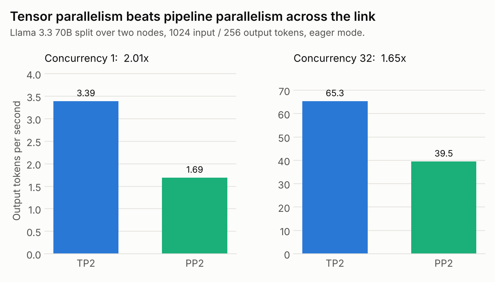

Pipeline parallelism's 1.69 tok/s is what one node would achieve if it could hold the whole model: both stages read all the weights in sequence for every token. Splitting by depth buys capacity on this hardware and nothing else. PP scales slightly better with concurrency (23.4x against 19.3x), but nowhere near enough to recover a 2x single-stream deficit.

### 6.2 One node versus two

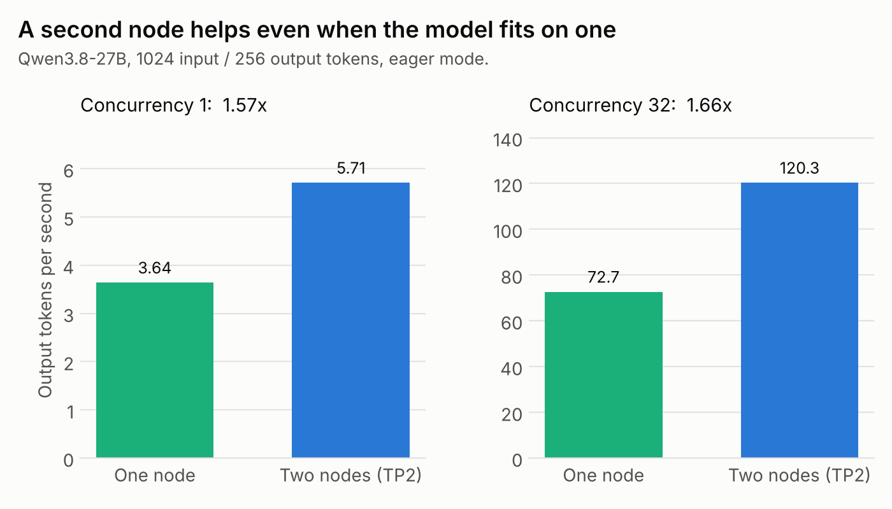

Qwen3.8 27B fits on one node. Splitting it anyway improved single-stream throughput 1.57x, per-token latency 1.77x and time to first token 1.35x. At concurrency 1 there is no batching to exploit, so the gain is memory bandwidth: each node reads half the weights, at the same time.

On cost: the second node buys about 1.6x for 2x the hardware. That is a latency and capacity win, not an efficiency win. The efficiency case is Llama 3.3 70B: 132 GB does not fit in one node's usable memory, so the second node is the difference between 3.39 tok/s and no service.

### 6.3 The bandwidth ceiling and the 30 ms constant

Decode streams the active weights out of memory for every token, so the ceiling is 273 GB/s divided by the bytes each node reads per token. Llama 3.3 70B reached 87.7% of that ceiling under TP2 and 87.3% under PP2: two strategies, two ceilings, near-identical efficiency.

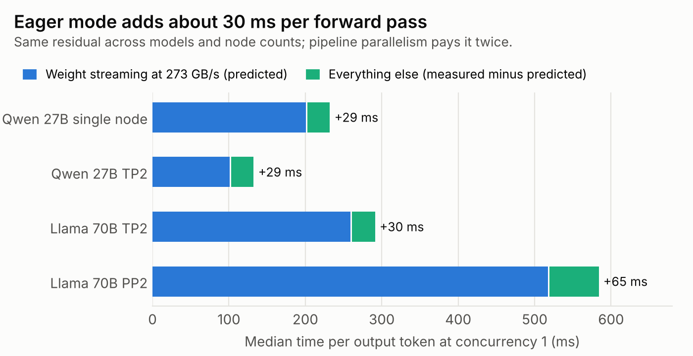

Subtracting predicted weight-streaming time from measured time per token leaves about 30 ms per sequential forward pass, nearly constant across model, architecture and node count. It covers everything that is not weight streaming: eager-mode kernel launches, collectives and scheduling. Pipeline parallelism pays it twice, since its two stages run in sequence.

That constant explains why smaller models fall further below the ceiling: 30 ms is 29% of Qwen's two-node token time and 12% of Llama's. It also predicts where compiled execution with CUDA graphs should pay off most: the small-model, low-latency corner. Section 8 tests this.

## 7. Moving to a native stack

The calibration phase rebuilt the software stack and the measurement method before any further throughput claims. Stack: DGX OS 7.6.0, kernel 7.0.0-1019-nvidia, driver 580.178.04, CUDA 13.0, vLLM 0.29.0, PyTorch 2.13.0, FlashInfer 0.6.18, NCCL 2.29.7, Ray 2.58.0.

| Finding | Measured |
|---|---|
| **vLLM runs natively on sm_121.** No container, no patching. Do not install `flashinfer-cubin`: its version check hard-fails | `uv pip install vllm==0.29.0 --torch-backend=auto` on both nodes |
| **Weight loading is 44x faster with `fastsafetensors`** | 6.90 s versus 302.9 to 389.5 s for Qwen3.8 27B BF16 |
| **CUDA graphs are safe here and cheap to compile** | 15 to 17 s compile, correct output at concurrency 64; the pilot avoided them after a 37-minute compile |
| **Lower precision buys capacity** | NVFP4 weights hold 1.64x the KV-cache tokens of BF16; an FP8 KV cache adds 1.35x with BF16 weights |
| **One node saturates early** | 120.7 tok/s at 64 concurrent requests; about 142 tok/s at the 191-sequence ceiling. Three times the concurrency bought 18% |
| **Tensor-parallel traffic is small** | 3.68 MB per output token, one way per node, split across both RDMA rails |
| **Two harnesses agree** | `vllm bench serve` 118.98 and AIPerf 118.91 output tok/s on identical inputs, a 0.06% gap |

Data: [`results/phase0/`](results/phase0/).

### 7.1 Why a correctness gate

A published two-Spark DeepSeek V4 Flash recipe reported 300 tok/s at 16 streams, then found the model was answering every prompt with `1. 2. 3. 4. ...` once CUDA graphs and more than two sequences were combined. With graphs off, the coherent figure was 269 tok/s ([source](https://github.com/Mirrdhyn/dsv4-flash-dgx-spark)). Nothing in the logs flagged it.

So every configuration here passes a gate before its throughput counts:

1. **Smoke:** "The capital of France is" must contain Paris; 17 x 23 must return 391.
2. **Echo ownership:** 64 or more concurrent requests each ask the model to repeat a unique random six-digit number. Every response must contain its own number and no other request's number, at concurrency 1 and again at full concurrency.

The gate also showed why simpler checks fail. At temperature 0, vLLM output is **not** batch-invariant. When 43 responses from a 256-request run were replayed one at a time, 4 came back worded differently: a different batch size changes floating-point reduction order and can flip near-tie tokens. None of the four contained another request's number. Exact-text comparison across concurrency levels is therefore not a valid correctness test; ownership is.

### 7.2 Platform traps

| Trap | What happens | Fix |
|---|---|---|
| Gloo binds to loopback | Two-node TP fails with `Gloo connectFullMesh failed`, even though NCCL is configured | Set `GLOO_SOCKET_IFNAME` as well as `NCCL_SOCKET_IFNAME` on both nodes, before `ray start` |
| Ray workers inherit the wrong environment | Workers take the environment of the shell that started Ray, not a later one; a missing `nvcc` silently changes code paths | Export everything before `ray start` |
| Just-in-time kernel builds run out of memory | FlashInfer compiles kernels at first use with the model already resident; parallel `nvcc` jobs exhaust unified memory and the engine is killed | Bound with `MAX_JOBS=2` and `FLASHINFER_NVCC_THREADS=2`; build kernels offline before the first launch that needs them |
| Page cache competes with the GPU | Unified memory means file cache shrinks what the model can use | Drop caches before every launch; swap off; memory fraction 0.85 on one node, 0.80 for two-node TP |
| GPU firmware timeout after idle | After about two weeks idle, one node showed `ERR!` in `nvidia-smi` and an Xid 119 GSP timeout | Check `nvidia-smi` at the start of every session; a reboot cleared it, and a 15 s matmul burn confirmed recovery |
| `nvidia-smi` memory fields | Read `N/A` on GB10 | Use vLLM's `cache_config_info` metric and OS memory |
| NVFP4 output-layer fallback | The FP4 autotuner has no tuned config for the output projection at some token counts and falls back silently | Grep logs for `No tuned config covers` on every NVFP4 launch |

## 8. Revisiting the pilot on the compiled stack

Section 6.3 claimed the eager-mode numbers were floors and that CUDA graphs would remove most of the 30 ms constant. The closing session reran the pilot's Qwen and Llama TP2 cells on the native compiled stack to test that, with predictions committed before the first run.

Same workload as the pilot: random dataset, 1024 input / 256 output tokens, seed 0, concurrency 1 and 32. Differences, all intentional: vLLM 0.29.0 native, CUDA graphs on (full and piecewise capture, batch sizes 1 to 128, confirmed in both two-node server logs), `--load-format fastsafetensors`, `--generation-config vllm`, two warmup requests, and 10 / 160 prompts instead of 5 / 64. Every configuration passed the section 7.1 gate before its numbers counted.

| Config | Weight streaming | Pilot median TPOT (eager) | Predicted (compiled) | Measured | Outcome |
|---|---:|---:|---:|---:|---|
| Qwen3.8 27B, one node | 201 ms | 230.1 ms | 203 to 212 ms | 210.1 ms | **Confirmed** |
| Qwen3.8 27B, TP2 | 100.5 ms | 130.4 ms | 103 to 115 ms | 115.3 ms | **Missed** by 0.3 ms |
| Llama 3.3 70B, TP2 | 259 ms | 289.2 ms | 261 to 272 ms | 290.0 ms | **Falsified** |

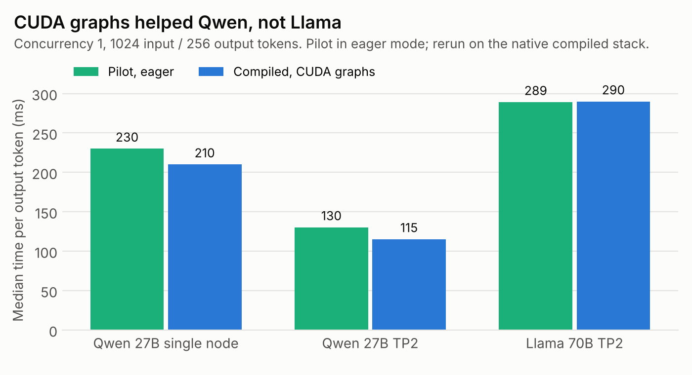

| Prediction | Pilot | Predicted | Measured | Outcome |
|---|---|---|---|---|
| Residual per-token overhead at concurrency 1 | ~30 ms | 12 ms or less in all three | 9.1 / 14.8 / 31.0 ms | **Falsified:** met on one node only |
| Qwen two-node per-token speedup | 1.77x | 1.80x to 1.95x | 1.82x | **Confirmed** |
| Output tok/s at concurrency 32 | 72.69 / 120.34 / 65.31 | each 5% to 35% higher | 86.70 (+19.3%) / 150.24 (+24.8%) / 64.07 (-1.9%) | **Falsified** on Llama |
| DeepSeek V4 Flash 0731 NVFP4, stock stack, TP2 | not run | more likely fails to load or fails the gate than serves | failed before loading weights | **Confirmed** |
| GSM8K, 200 items, relative to BF16 | not run | FP8 within 2 points, NVFP4 within 3 | FP8 +3.0, NVFP4 -5.5 | **Falsified** as stated; see 8.3 |

Three follow-ups ran the same day, each with its prediction committed first:

| Prediction | Predicted | Measured | Outcome |
|---|---|---|---|
| F1. Cross-node all-reduce at Llama's per-token message (16 KB), replayed in a CUDA graph | 10 to 40 µs; collectives explain under a third of Llama's residual | 52.7 to 57.6 µs; 8.6 to 9.0 ms per token, 28 to 29% of the residual | **Falsified** on latency, **confirmed** on the conclusion |
| F2. DeepSeek V4 Flash, second attempt with an FP8 KV cache | fails before health on a kernel or architecture error | stopped by rule at 57 s when DeepGEMM began a JIT compile | **Partly confirmed:** the blocker is DeepGEMM, but the stop was the test's own rule |
| F3. GSM8K, all 1,319 items, paired against BF16 | FP8 within 2 points, not significant; NVFP4 2 to 6 points below, significant | FP8 -1.8 (p = 0.037); NVFP4 -13.7 (p < 0.0001) | **Falsified:** FP8's small loss is significant; NVFP4's is more than twice the predicted band |

Of eight predictions, two held outright and two in part. Data: [`results/closing/`](results/closing/).

### 8.1 The constant is gone on Qwen and untouched on Llama

CUDA graphs cut the residual from 29 ms to 9 ms on one node and from about 30 ms to 15 ms for Qwen under TP2. On Llama TP2 it did not move: 30.2 ms eager, 31.0 ms compiled. Throughput at concurrency 32 tells the same story: Qwen gained 19% and 25%, Llama lost 2%.

Graph capture was confirmed in the Llama log, including batch size 1, so the remaining constant is not kernel-launch overhead. It is not link bandwidth either: Llama moved 6.50 MB per output token over RDMA, under 0.3 ms at 24.5 GB/s.

**Collectives, measured directly (F1).** A cross-node all-reduce at Llama's per-token message size takes 54 to 56 µs when replayed inside a CUDA graph, the way decode runs it. Llama runs two per layer, 160 per token: 8.6 to 9.0 ms, under a third of the 31 ms.

- **Qwen decomposes cleanly.** Its 128 collectives cost 6.7 to 7.4 ms, close to the 5.7 ms that TP2 adds to its one-node residual. Qwen's overhead is a base of about 9 ms plus the collectives.
- **Llama does not.** Subtracting its collectives leaves about 22 ms, more than twice Qwen's base. That remainder was not isolated; a profile of one Llama decode step is the next measurement.
- **Collectives are slower inside a graph.** In the same test, eagerly enqueued all-reduces took 18 to 20 µs each, about a third of the graph-replayed time. At Llama's 160 per token, that difference is about 5.6 ms. Why NCCL is slower inside a graph on this link was not investigated.

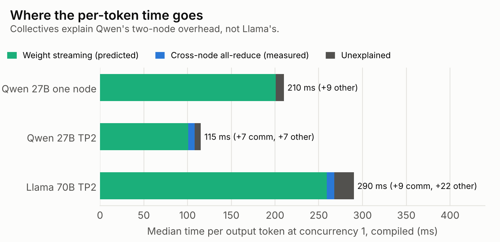

The practical reading: for a model that fits on one node, compiled execution brings decode within 5% of the memory-bandwidth ceiling. For the 70B model that needs two nodes, about 22 ms per token beyond weight streaming and collectives is still unaccounted for.

### 8.2 DeepSeek V4 Flash on the stock stack

The first attempt failed 38 seconds in, before loading weights:

```text
AssertionError: DeepseekV4 fp8_ds_mla layout only supports fp8 kv-cache, got auto
```

That is further than the pilot got: vLLM 0.29.0 recognizes the architecture, and the model requires an FP8 KV cache that the standard two-node recipe does not set.

A second attempt (F2) added `--kv-cache-dtype fp8`. It passed that check, and 57 seconds in DeepGEMM began compiling a kernel for the `sm_120f` Blackwell family target. A cold JIT compile during model load is a stop condition here, because such builds can exhaust unified memory (section 7.2), so the run stopped. Whether the compile would succeed, and whether the model would then serve correctly, is unknown.

For context, the one published two-Spark run needed an unmerged vLLM change, a patched DeepGEMM, and a newer CUDA and driver, and it produced incoherent output above two concurrent sequences with CUDA graphs on ([source](https://github.com/Mirrdhyn/dsv4-flash-dgx-spark)). The next step here is a bounded compile (two parallel jobs, memory watchdog on) followed by the correctness gate, which is built to catch exactly that failure.

### 8.3 Precision and answer quality

Qwen3.8 27B on one node at each precision, full gate first, then GSM8K: 5-shot, greedy, through the completions endpoint. The closing run used the first 200 items. A follow-up (F3) ran all 1,319 test items and compared precisions item by item.

| Precision | Flexible extract | Strict match | Flexible vs BF16, paired 95% CI | McNemar p | First 200 items, flexible |
|---|---:|---:|---:|---:|---:|
| BF16 | 73.1% | 70.5% | | | 67.5% |
| FP8 | 71.3% | 68.9% | -1.8 (-3.5 to -0.2) | 0.037 | 70.5% |
| NVFP4 | 59.4% | 55.8% | -13.7 (-16.2 to -11.1) | < 0.0001 | 62.0% |

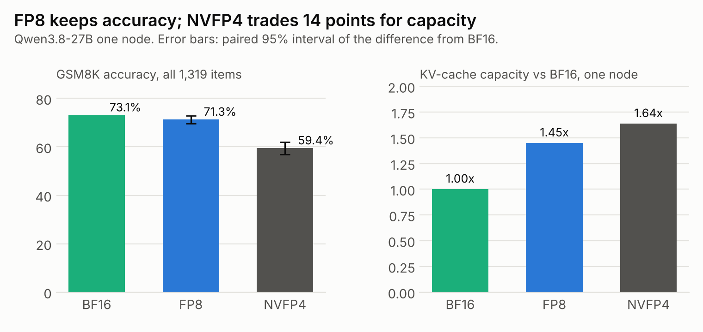

- **NVFP4 loses about 14 points.** On the same items, BF16 answered 249 correctly that NVFP4 missed; NVFP4 answered 69 that BF16 missed. Strict match agrees (-14.7). That is more than twice the predicted 2 to 6 points, and larger than losses usually reported for 4-bit formats. Whether the cause is the checkpoint's quantization or the sm_121 NVFP4 kernels (section 7.2 lists a silent output-layer fallback) was not isolated.
- **FP8 costs about 2 points.** Small, but significant on flexible extract (p = 0.037) and borderline on strict match (p = 0.053).
- **200 items were too few.** The subset ranked FP8 above BF16, and BF16's score moved 5.6 points between the subset and the full set. The original 2 and 3 point bands were narrower than 200 items can resolve, a flaw in the prediction that the full set corrected.

Together with section 7: NVFP4 holds 1.64x the KV-cache tokens of BF16 and costs 14 points on multi-step arithmetic in this harness. FP8 keeps nearly all of the accuracy.

The absolute scores reflect this harness (raw completions prompts, no chat template, thinking off) and should not be compared with published GSM8K results. Compare across precisions only.

## 9. When the second Spark is worth it

Sections 6 and 8 measured two load points. This section sweeps load from 1 to 256 concurrent requests for three ways to use the hardware, then repeats the one-node versus two-node comparison on a real long-document workload. Eight predictions were committed before the runs. Data: [`results/sweep/`](results/sweep/).

| Setup | What runs | Memory fraction |
|---|---|---|
| One node | Qwen3.8 27B BF16 on one Spark | 0.85 |
| TP2 | One server split across both Sparks | 0.80 per node |
| DP2 | Two independent copies, one per Spark, requests split evenly | 0.80 per node |

Every server ran with up to 256 concurrent sequences and passed the section 7.1 gate at 256 concurrent requests, plus three more echo seeds at the same concurrency. Same synthetic workload as the pilot (1024 input / 256 output tokens), client on the second Spark.

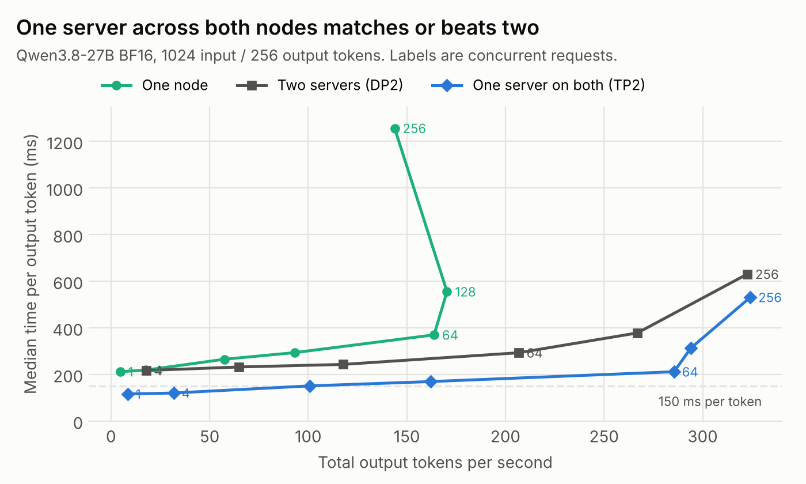

| Concurrency | One node, tok/s | DP2, tok/s | TP2, tok/s | TP2 over DP2 | TP2 median TPOT |
|---:|---:|---:|---:|---:|---:|
| 1 | 4.7 | | 8.5 | | 116 ms |
| 4 | 17.6 | 18.0 | 31.8 | 1.77x | 120 ms |
| 16 | 57.5 | 64.9 | 100.8 | 1.55x | 151 ms |
| 32 | 93.1 | 117.7 | 162.1 | 1.38x | 170 ms |
| 64 | 163.8 | 206.6 | 285.5 | 1.38x | 212 ms |
| 128 | 170.4 | 266.9 | 294.1 | 1.10x | 314 ms |
| 256 | 143.8 | 322.6 | 324.2 | 1.00x | 531 ms |

DP2 at concurrency 1 is not defined: one request reaches only one server.

### 9.1 TP2 never lost

The prediction was that two independent servers would overtake TP2 once there was enough load to keep both busy. They did not: TP2's lead shrank from 1.77x at 4 requests to a tie at 256, and never reversed.

The reason is the same as in section 6.2. TP2 makes both nodes read half the weights for every token, so each request runs about twice as fast. DP2 runs two requests at one-node speed. At low load TP2's speed wins outright; at saturation both setups are limited by the same two memory systems and deliver the same total. TP2 also pools both nodes' KV cache into one scheduler, which helps it absorb uneven load.

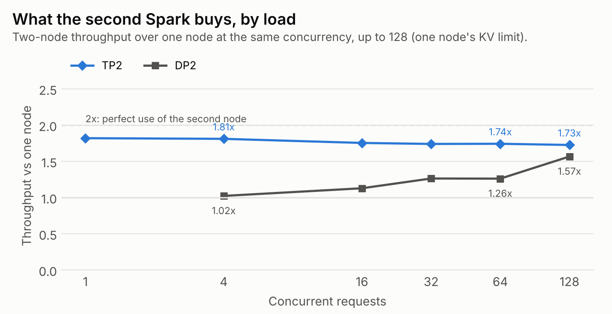

The ratio view makes the gap plain. TP2 delivers 1.73x to 1.82x one node at every load up to 128. DP2 starts at 1.02x, because at 4 requests each copy serves two at one-node speed, and climbs only as load fills both copies.

**Practical reading:** on this hardware, a second Spark is better used as half of one server than as a second server, at every load measured. Running two copies buys nothing TP2 does not, and loses per-request speed. TP2 is also the only setup that stays under 150 ms per token (about reading speed): up to 16 concurrent requests. One node and DP2 never get below 212 ms.

### 9.2 One node runs out of room

One node peaked at 170 tok/s at 128 requests and fell to 144 at 256, with median time per token rising from 555 ms to 1,257 ms. At 256 requests it exceeds its KV-cache capacity (about 191 sequences, section 7), so requests wait or are preempted. Neither two-node setup reached that wall within 256.

### 9.3 Long documents

One hundred GovReport documents (GAO and CRS reports, median 9,033 tokens, up to 25,739), each summarized in three parts with up to 1,024 output tokens, 16 at a time, thinking off. Quality is ROUGE against the expert-written summaries.

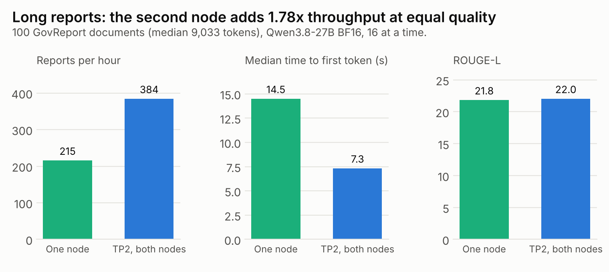

| Setup | Reports per hour | Median TTFT | p95 TTFT | Median TPOT | ROUGE-1 / 2 / L |
|---|---:|---:|---:|---:|---|
| One node | 215.5 | 14.5 s | 99.3 s | 525 ms | 47.5 / 17.5 / 21.8 |
| TP2 | 384.2 | 7.3 s | 59.4 s | 296 ms | 47.9 / 17.6 / 22.0 |

The second node gives 1.78x on this workload, close to its 1.82x single-stream gain on short prompts. Time to first token halves (0.51x), because TP2 splits the prefill compute as well as the weight reads. Summary quality is unchanged (ROUGE-L 21.8 against 22.0).

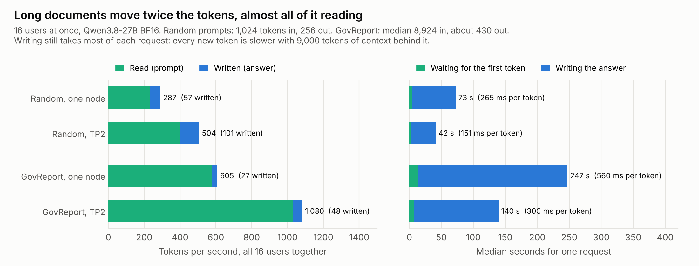

At the same 16 users, long reports move twice the tokens per second of the synthetic workload, nearly all of it prefill, while each output token is about twice as slow (300 against 151 ms on TP2) because it attends over a 9,000-token context.

Both setups failed the interactive targets set in advance (p95 TTFT under 15 s, p95 TPOT under 100 ms). At 16 long documents at a time, this is a batch workload: a report finishes every 9.4 s on TP2, but any single report can wait a minute for its first token.

### 9.4 Correctness at scale

Across the session, 16 echo checks at 256 concurrent requests (4,096 requests) and two at 64 returned every request's own number and no other request's. Zero failures in 4,096 bounds the contamination rate below 0.07% at 95% confidence.

### 9.5 Predictions

| Prediction | Predicted | Measured | Outcome |
|---|---|---|---|
| S1. One-node ceiling | 135 to 150 tok/s by 128 requests | 170.4 at 128, then 143.8 at 256 | **Falsified:** higher, then fell |
| S2. DP2 against one node at half the concurrency | 1.9x to 2.0x from 64 up | 2.22x, 1.63x, 1.89x at 64, 128, 256 | **Falsified:** wider spread; DP2 ran at 0.80 against one node's 0.85 |
| S3. TP2 against DP2 | TP2 ahead up to 64; DP2 overtakes at 128 or 256 | TP2 ahead at every point, tied at 256 | **Falsified:** DP2 never overtook |
| S4. Under 150 ms per token | One node and DP2 never; TP2 up to 4 to 16 | One node and DP2 never; TP2 up to 16 (151 ms) | **Confirmed** |
| E1. Cross-request contamination | zero in at least 3,072 requests at 256 | zero in 4,096 | **Confirmed** |
| G1. GovReport, TP2 over one node | 1.7x to 2.0x | 1.78x | **Confirmed** |
| G2. GovReport quality | ROUGE-L within 0.5 | +0.2 | **Confirmed** |
| G3. GovReport TTFT | TP2 at most 0.6x one node | 0.51x | **Confirmed** |

**One run was stopped and repeated.** The first DP2 attempt ran its server at 0.85 on the node that also hosted the benchmark client. The client took free memory under the watchdog's 6 GiB threshold, and the watchdog stopped that server seven seconds into the sweep. The cause and the rerun settings (0.80 on both nodes, the same as TP2) were recorded before the rerun. The stopped attempt's data is not used.

## 10. Known limits

- **Nemotron 3 Super 120B (NVFP4) did not serve.** With every kernel prebuilt offline, the launch completed CUDA graph capture, then free memory fell below 6 GiB during MoE kernel autotuning (peak 115.9 GiB in use). The memory watchdog stopped it, as designed. The allocation behind the growth was not isolated.
- **Llama 3.3 70B TP2 keeps about 22 ms of unexplained per-token overhead with CUDA graphs on,** after subtracting measured collectives. Graph capture was confirmed; the step was not profiled (section 8.1).
- **DeepSeek V4 Flash did not serve.** A second stock attempt reached a DeepGEMM JIT compile and was stopped by rule; a bounded compile was not tried (section 8.2).
- **One quality benchmark.** GSM8K measures multi-step arithmetic only. NVFP4's 14-point loss was not traced to the checkpoint or the kernels, and absolute scores are specific to this harness (section 8.3).
- **Gemma 4 was not served.** The test plan required someone physically present in case a launch hung the machine, and that session did not happen.
- **One model in the sweep.** The concurrency sweep and GovReport used Qwen3.8 27B BF16 only. A model too large for one node (Llama 3.3 70B) was not swept.
- **Power is board-reported.** GPU-reported SoC power, not wall power.
- **One hardware pair, mostly synthetic traffic.** Results describe two DGX Sparks on a direct link. Apart from GovReport (section 9.3), prompts are fixed-length synthetic text, not production request mixes.
- **No fine-tuning.** Every model runs as published.

## 11. How it was run

The cluster was operated from a laptop. Planning, review and documentation were done with an AI assistant (Claude). Execution was handed to a coding agent (OpenAI Codex) that ran commands on both nodes over SSH, following written procedures ([`docs/VALIDATION.md`](docs/VALIDATION.md)).

Guardrails made it safe to leave the agent running:

- **Scoped privilege.** The agent's account could run exactly one command as root without a password: dropping the page cache. Every `sudo` call used `sudo -n`, so anything else failed immediately instead of waiting on a prompt.
- **One launch wrapper.** Every server started through [`launch.sh`](validation/bin/launch.sh) in its own process group, with an independent memory watchdog that kills the whole group if free memory stays below 6 GiB for three seconds.
- **Hard stop rules.** No retries after an out-of-memory stop, a hang, a GPU error or a failed correctness gate. No unattended reboots. The agent stops and reports.
- **Correctness before throughput.** No number counted until its configuration passed the gate in section 7.1.

The Nemotron stop in section 10 is the guardrails working: the watchdog ended the launch before the node ran out of memory, and the agent stopped instead of retrying.

## Appendix: reproducing

- Build the cluster: [`docs/SETUP.md`](docs/SETUP.md)
- Certify a configuration before benchmarking it: [`docs/VALIDATION.md`](docs/VALIDATION.md)
- Scripts and unit tests: [`validation/`](validation/)
- Figures: `python3 scripts/make_figures.py` regenerates every chart from [`results/`](results/)
